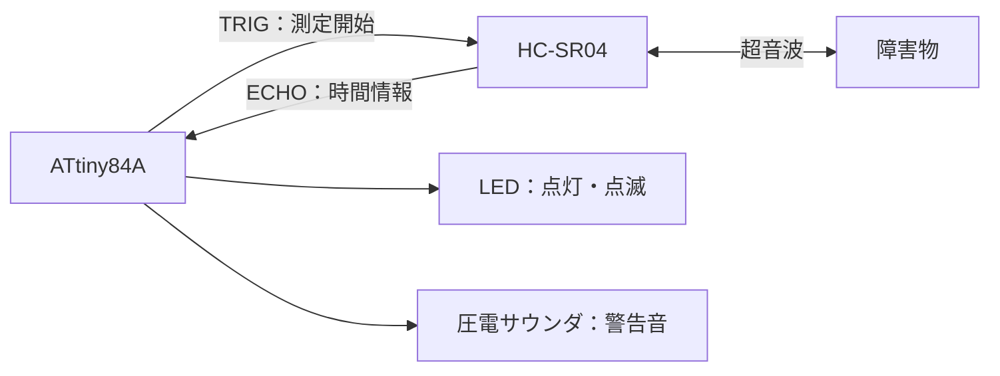

# Parking Assist Alarm System

超音波距離センサーで障害物までの距離を測定し、LEDと圧電サウンダで接近を知らせる、大学の授業で製作した駐車支援システムです。

[実機写真](media/overview.jpg) / [動作動画](media/demo.mp4) / [発表スライド](docs/presentation.pptx)

授業で製作したオリジナルのC言語版は[`main.c`](main.c)に保存しています。C++のクラス設計を学ぶため、Codexの支援で[`main.cpp`](main.cpp)を新たに作成しました。C++版はビルド確認済み・実機未検証です。設計と検証結果は[「8. C++版へのリファクタリング」](#8-c版へのリファクタリング)にまとめています。

## 1. プロジェクト概要

マイコンによる入出力制御、センサー計測、時間制御の基本原理を学ぶことを目的に製作しました。障害物までの距離に応じて、LEDの点灯・点滅と警告音の周波数・間隔を変え、接近を知らせます。

| 項目 | 使用技術・部品 |
| --- | --- |
| マイコン | ATtiny84A |
| 距離センサー | HC-SR04（超音波距離センサー） |
| 出力装置 | LED、圧電サウンダ |
| プログラミング言語 | C（オリジナル版・AVR-GCC）、C++11（学習用リファクタリング版・AVR-G++） |
| コード上のクロック周波数設定 | 8MHz（`F_CPU = 8000000UL`） |

`F_CPU`は遅延処理などの計算に用いるクロック周波数の定義であり、定義するだけでマイコンの実際のクロックが8MHzに設定されるわけではありません。実機のクロック源・分周・ヒューズ設定とコードの設定が一致するかは未確認です。

## 2. システム構成

ATtiny84AがHC-SR04へ測定開始信号を送り、返されたECHO信号を読み取ります。計算した距離に応じてLEDと圧電サウンダを制御します。



| ポート名 | スライドの回路図での表記 | 接続先・役割 |
| --- | --- | --- |
| PA0 | ADC0 | HC-SR04のTRIGへ出力 |
| PA1 | ADC1 | HC-SR04のECHOから入力（`PINA`で読み取り） |
| PA2 | ADC2 | 圧電サウンダへ出力 |
| PA3 | ADC3 | LEDへ出力 |

上表は`main.c`・`main.cpp`共通のポート割り当てと、スライドの回路図での表記の対応です。ATtiny84Aでは`PA0`〜`PA3`に`ADC0`〜`ADC3`の機能名もあり、同じ端子を表します（[Microchip公式データシート](https://www.microchip.com/content/dam/mchp/documents/MCU08/ProductDocuments/DataSheets/ATtiny24A-44A-84A-DataSheet-DS40002269A.pdf)）。スライドの回路図の接続先は、コードのピン割り当てと対応しています。

## 3. 動作の仕組み

1. TRIGをLOWで2µs、HIGHで10µs保持した後にLOWへ戻し、超音波の送信を開始します。
2. ECHOの立ち上がりを待ち、HIGHの間、カウンタの加算と`_delay_us(1)`を繰り返します。
3. カウンタ値を往復時間の近似値として、音速を使って距離を求めます。
4. 距離の範囲を判定し、LEDと圧電サウンダの警告パターンを切り替えます。

距離計算の基本式とコード上の計算は次のとおりです。往復の時間なので、片道の距離を求めるために2で割ります。

```text
距離 = 音速 × 超音波の往復時間 ÷ 2

コード上の計算：distance = duration * 0.034 / 2
```

`0.034`は音速をcm/µs単位で近似した係数です。`duration`を1µs刻みの時間として計算していますが、実際にはループ処理の時間も含まれます。結果は`long`型に格納されるため、小数点以下は切り捨てられます。

警告パターンは次のとおりです。周波数・時間はいずれもコード上の設定値であり、実測値を保証するものではありません。

| 距離 | LED | 警告音 |
| --- | --- | --- |
| 0cm超〜5cm未満 | 点灯 | 1500Hz、50ms |
| 5〜15cm未満 | 点滅 | 1200Hz、75ms鳴動・75ms停止 |
| 15〜30cm未満 | 点滅 | 1000Hz、100ms鳴動・300ms停止 |
| 30cm以上 | 消灯 | 無音 |

5〜15cm未満ではLEDを点灯して75msの発音処理を行い、その後LEDを消灯して75ms待ちます。15〜30cm未満ではLEDを点灯して100msの発音処理を行い、その後LEDを消灯して300ms待ちます。

0cm超〜5cm未満ではLEDを点灯して50msの発音処理を行います。どの範囲でも警告処理の後に再測定するため、最も近い範囲も測定を挟む発音であり、完全な連続音ではありません。

ECHOの待機と計測には、それぞれ最大40,000回のループ制限があります。タイムアウト時は計測値を0にします。距離が0cmの場合も警告を停止するため、計測失敗と30cm以上を警告だけで区別できません。また、計算結果が1cm未満の場合も整数への切り捨てで0cmとなり、警告しません。

## 4. 製作で取り組んだこと

大学の電気電子工学系の授業で製作しました。C言語コードの大部分は生成AI（Claude）の支援で作成し、各処理の意味や動作原理を理解しながら製作を進めました。

自分で担当した作業と学んだ内容は次のとおりです。

- 回路の配線と実機での動作確認。
- マイコンの入出力制御、距離測定、警告処理の動作原理の理解。
- RAMなどの資源制約を意識した、変数のデータ型の検討。
- 可変の遅延時間を扱う関数と、警告音を生成する関数の仕組みの学習。

今回のC++版は、上記の授業制作後にCodexの支援を利用して作成した学習用のリファクタリングです。C言語版の制作時の実機確認と区別し、C++版の実機での動作確認や性能測定はまだ行っていません。

## 5. 技術的な工夫

製作で扱った技術上のポイントは次のとおりです。

- **レジスタによるGPIO制御**：`DDRA`で入出力方向を設定し、`PORTA`への書き込みと`PINA`の読み取りでセンサー・LED・圧電サウンダを扱います。
- **超音波の往復時間による距離計算**：ECHO信号の長さを距離に換算し、警告の判定に利用します。
- **矩形波による警告音生成**：指定周波数から半周期を計算し、HIGHとLOWを交互に出力します。可変の待ち時間は、`_delay_us(1)`を繰り返す関数で扱います。
- **距離に応じた条件分岐**：距離を複数の範囲に分け、警告音の周波数や断続パターンを切り替えます。
- **限られたメモリ容量への配慮**：変数が扱う値の範囲と必要な精度を考え、使用するデータ型を検討しました。授業での製作時にはメモリ使用量の削減効果を定量評価していません。今回のC/C++版のビルドサイズは「8. C++版へのリファクタリング」に掲載しています。

## 6. 既知の課題・今後の改善

以下は現在の実装にある課題と今後の改善案です。改善案は実施済みの機能ではありません。

| 課題・確認点 | 今後の改善案 |
| --- | --- |
| ECHO計測は`_delay_us(1)`以外のループ処理も含むため、カウンタ値と実際の経過時間が一致しない。 | ハードウェアタイマーでECHO信号の時間を測る方式を検討し、既知の距離と比較して評価する。 |
| タイムアウトは40,000回の反復で判定する。立ち上がり待機とHIGH計測ではループ内の処理が異なり、どちらも40msを保証しない。 | タイマーを使い、実時間に基づくタイムアウトに改める。 |
| 測定値の平均化などは行っておらず、計測失敗や整数への切り捨てによる0cmも警告停止になる。 | 複数回の測定結果を利用して安定化し、計測失敗と有効な距離を区別する方法を検討する。 |
| 警告音の半周期もソフトウェアループで生成するため、出力操作・関数呼び出しなどが設定周波数や発音時間に影響する。 | タイマーによる波形生成を検討し、実際の周波数・時間を測定して評価する。 |
| 発音処理や待ち時間の間は次の距離測定を行わず、距離ごとに再測定までの間隔が変わる。 | 必要に応じてタイマーや状態管理を使い、警告動作を非ブロッキング化する。 |
| コード上の8MHz設定と実機クロックの一致が未確認。 | クロック源、分周、ヒューズ設定を確認し、計測・警告音の時間計算と対応させる。 |

### C言語版のビルド確認

2026年10月21日、公開する`main.c`をWindows環境でビルドし、警告・エラーなしでコンパイルとリンクが成功することを確認しました。Intel HEX形式のファイル生成も確認済みです。今回のC++版との比較でも、元の`main.c`を変更せずに再ビルドしています。

使用したツールチェーンはArduino公式配布のAVR-GCC（`7.3.0-atmel3.6.1-arduino7`、GCC 7.3.0、avr-libc 2.0.0）です。配布元とチェックサムは[Arduino公式パッケージ一覧](https://downloads.arduino.cc/packages/package_index.json)で確認できます。次のコマンド相当で検証しました。

```sh
avr-gcc -mmcu=attiny84a -DF_CPU=8000000UL -std=gnu99 -Os -Wall -Wextra main.c -o parking-assist-alarm-c.elf
avr-objcopy -O ihex -R .eeprom parking-assist-alarm-c.elf parking-assist-alarm-c.hex
avr-size parking-assist-alarm-c.elf
```

このビルドの`avr-size`出力は`text = 1340`、`data = 18`、`bss = 0`（単位：バイト）でした。静的RAM使用量（`data + bss`）は18バイトで、スタック使用量は含みません。生成ファイルは検証用の一時フォルダに置き、リポジトリには含めていません。

対象デバイスは[GCCのAVRオプション](https://gcc.gnu.org/onlinedocs/gcc/AVR-Options.html)に記載されています。`_delay_us()`・`_delay_ms()`は最適化を有効にしたビルドを前提とするため、`-Os`を指定しています（[avr-libcの遅延関数仕様](https://www.nongnu.org/avr-libc/user-manual/group__util__delay.html)）。これらのコマンドは実機への書き込みやヒューズ設定を行いません。

今回確認したのはビルドとファイル生成であり、実機での再動作確認、距離の計測精度、警告音の実周波数の評価は行っていません。製作時には回路の配線と実機での動作確認を行っていますが、定量評価のデータは掲載していません。

## 7. 実機写真・動作動画・発表資料

以下は授業で製作したC言語版の記録です。C++版の実機検証を示すものではありません。

### 完成品の写真


### 動作動画

[実機の動作動画を開く（MP4・約19秒・約12MB）](media/demo.mp4)

GitHub上で再生できない場合は、[動画をダウンロード](https://raw.githubusercontent.com/2114-takumi/parking-assist-alarm/main/media/demo.mp4)してご覧ください。

### 発表スライド

[成果報告会の発表スライドをダウンロード（PPTX・全5枚）](https://raw.githubusercontent.com/2114-takumi/parking-assist-alarm/main/docs/presentation.pptx)

[GitHub上のスライドのファイルページ](docs/presentation.pptx)からもダウンロードできます。

授業の成果報告用に作成した資料です。使用部品、システム構成、変数のデータ型、警告音を生成する関数について説明しています。公開用コピーでは、学籍番号、発表者ノート、作成者などの個人メタデータと学籍番号が残るサムネイルを除いています。

発表当時の説明を残しているため、資料中の`_delay_us()`を「マクロ」とする説明について補足します。実際にはinline関数であり、適切な動作には最適化と、コンパイル時に確定する遅延値が必要です（[avr-libc公式仕様](https://avrdudes.github.io/avr-libc/avr-libc-user-manual/group__util__delay.html)）。

## 8. C++版へのリファクタリング

### 目的とC言語版との違い

`main.cpp`は、元の処理を役割ごとにクラスへ分け、C++の設計を学ぶために作成しました。`main.c`は今回の変更で一切変更していません。両ファイルはそれぞれ独立したプログラムなので、ビルドする版を1つ選びます。

| 観点 | C言語版：`main.c` | C++版：`main.cpp` |
| --- | --- | --- |
| 構造 | `main()`と独立した関数に処理を記述 | センサー・発音・全体制御を3クラスに分ける |
| 初期設定 | `main()`内でGPIOを設定 | 各クラスのコンストラクタで担当するGPIOを設定 |
| 定数 | ピンのマクロとファイルスコープの`const`変数 | 担当クラス内の`private static constexpr`定数 |
| 呼び出し | `beep()`などを直接呼ぶ | `sensor_.measureDistanceCm()`・`buzzer_.beep()`などを呼ぶ |
| 計測・警告方式 | ソフトウェアループ、ブロッキング処理 | 元の方式を維持 |

### クラス設計と学習のポイント

| クラス | 役割 | 外部から利用する主な処理 |
| --- | --- | --- |
| `UltrasonicSensor` | TRIG出力、ECHO読み取り、タイムアウト、距離計算 | `measureDistanceCm()` |
| `Buzzer` | 矩形波と指定時間の警告音を生成 | `beep(frequency, durationMs)` |
| `ParkingAssist` | 測定と警告を繰り返し、距離に応じてLED・発音を制御 | `run()` |

クラスを使うことで、その部品に関係する設定と処理をまとめます。例えば、センサーの利用側は`measureDistanceCm()`を呼べばよく、TRIGを操作する手順やタイムアウト処理を毎回扱う必要がありません。

- **`public`と`private`**：`public`はクラスの外から使う入口です。`private`は内部だけで使う定数や補助処理です。例えば`Buzzer::beep()`は公開し、半周期を待つ`variableDelayUs()`は内部に隠しています。
- **コンストラクタ**：オブジェクトを作るときに一度実行される初期設定です。`main()`内の`ParkingAssist parkingAssist;`で全体のオブジェクトを生成します。`ParkingAssist() : sensor_(), buzzer_()`の初期化リストによって部品も生成され、メンバの宣言順にセンサー（TRIG・ECHO）、サウンダ、その後コンストラクタ本体のLEDという順でGPIOを設定します。これはC版の設定順と同じです。
- **メンバによる構成**：`ParkingAssist`は`UltrasonicSensor sensor_;`と`Buzzer buzzer_;`を直接持ちます。「全体制御が必要な部品を持つ」という関係で、継承や仮想関数は使いません。
- **`static constexpr`**：`constexpr`はコンパイル時の定数式に使える値を定義します。`static`なメンバ定数にすることで、ピンや周波数などをオブジェクトごとの設定データとして持たずに扱います。今回の使い方では、これらの定数は生成コードに組み込まれています。
- **`static`な補助関数**：`Buzzer::variableDelayUs()`はオブジェクト固有の状態を使わないため、`static`メンバ関数にしています。`_delay_us(1)`を指定回数繰り返す、元のC版と同じ方式です。
- **`static_cast`による型変換**：`static_cast<long>(durationMs)`は、乗算前に値を32ビットの`long`へ変換します。このAVR環境では16ビットの`unsigned int`のまま`1000`を掛けると、75msや100msでは範囲を超えるためです。C版の`(long)duration_ms`と同じ変換をC++の構文で記述しています。
- **AVRレジスタ操作**：`DDRA |= (1 << PA0)`はPA0の方向ビットを1にして出力にします。`|=`で対象ビットを立て、`&= ~...`で下げることで、他の端子の設定を保ちます。出力は`PORTA`、入力状態の読み取りは`PINA`を使用します。

動的メモリ確保（`new`・`malloc`など）や`std::vector`・`std::string`・iostreamは使用しません。例外処理・RTTIにも依存せず、ビルド時に`-fno-exceptions -fno-rtti`を指定しています。クラスを使いながら、マイコンの限られたメモリに配慮した構成にしています。

### 維持した動作と実時間に関する注意

ピン割り当て、距離の条件分岐、警告音の周波数・鳴動時間・停止時間は「3. 動作の仕組み」のままです。距離計算`duration * 0.034 / 2`と`long`への変換による小数部の切り捨て、40,000回のループによるタイムアウト、0cm・タイムアウト時の警告停止も維持しています。主要な計算変数はC版と同じ型で、このAVR環境では`unsigned int`が16ビット、`long`・`unsigned long`が32ビットです。

発音処理と待ち時間はブロッキング方式のままで、その間は距離を再測定しません。タイマーへの置き換えや計測方式の変更は今回行っていません。クラス化やコンパイラのインライン化によって命令列が変わるため、ソフトウェアループで決まる実際の時間や周波数はC版と異なる可能性があります。実機での完全な動作一致や精度向上は確認していません。

### コンパイル方法と検証結果

2026年10月21日、Windows環境でAVR-G++を使用し、ATtiny84A・8MHz・C++11・`-Os`の条件でコンパイル、リンク、HEX生成を確認しました。C版・C++版ともに警告・エラーはありませんでした。ツールチェーンはC版と同じArduino公式配布の`7.3.0-atmel3.6.1-arduino7`（GCC/G++ 7.3.0、avr-libc 2.0.0）です。

AVRツールチェーンの`bin`をPATHに追加した環境で、リポジトリのルートから次のコマンドを実行できます。C版のコマンドは「6. 既知の課題・今後の改善」に掲載しています。

```sh
avr-g++ -mmcu=attiny84a -DF_CPU=8000000UL -std=c++11 -Os -Wall -Wextra -fno-exceptions -fno-rtti main.cpp -o parking-assist-alarm-cpp.elf
avr-objcopy -O ihex -R .eeprom parking-assist-alarm-cpp.elf parking-assist-alarm-cpp.hex
avr-size parking-assist-alarm-cpp.elf
```

両版を比較する場合はC版もビルドし、`avr-size parking-assist-alarm-c.elf parking-assist-alarm-cpp.elf`で並べて確認できます。

`avr-size`による今回のビルド結果は次のとおりです。単位はバイトです。

| 版 | `text` | `data` | `bss` | Flash（`text + data`） | 静的SRAM（`data + bss`） |
| --- | ---: | ---: | ---: | ---: | ---: |
| C版 | 1340 | 18 | 0 | 1358 | 18 |
| C++版 | 1336 | 0 | 0 | 1336 | 0 |

この条件ではC++版のFlashが22バイト、静的SRAMが18バイト少ない結果でした。静的SRAMの値は、実行中のローカル変数・関数呼び出しなどが使うスタックを含みません。C++版の総SRAM使用量が0という意味ではなく、最大スタック使用量も測定していません。実行速度や実機の消費電力・計測精度を比較した結果ではありません。

検証用のELF・HEXファイルはリポジトリには含めていません。ソースレビューでは判定境界（0、4、5、14、15、29、30cm）とタイムアウト処理をC版と照合し、生成コードでもGPIOの設定順を確認しました。これらは実機動作の検証ではなく、実機への書き込み、C++版の動作確認、実際の周波数・応答時間の測定は未実施です。

### コードを読む順序と今後の改善

学習時は、まず`main()`から`ParkingAssist::run()`をたどり、「測る→警告する」という流れを確認します。次に`updateAlarm()`をC版の条件分岐と比べ、`UltrasonicSensor::measureDistanceCm()`、`Buzzer::beep()`の順に読みます。最後にコンストラクタ・`private`の定数・メンバの宣言へ戻ると、処理を変えずに責務と公開範囲を整理した点を確認できます。

今後の確認事項は、C版とC++版を同じ実機・既知の距離で比較し、クロック設定、距離測定、警告音の周波数と時間を確かめることです。ハードウェアタイマーによる計測・波形生成、測定値の安定化、必要に応じた非ブロッキング化は、今後の改善案として検討します。
