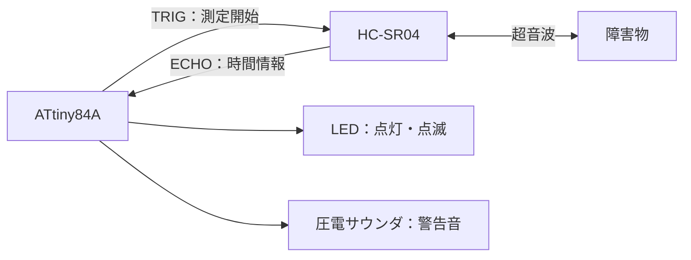
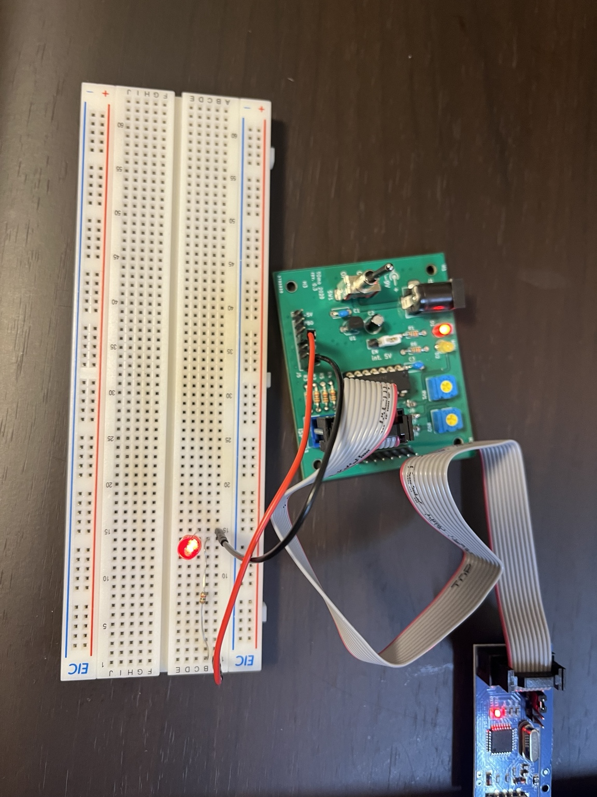

# Parking Assist Alarm System

超音波距離センサーで障害物までの距離を測定し、LEDと圧電サウンダで接近を知らせる、大学の授業で製作した駐車支援システムです。

[実機写真](media/overview.jpg) / [動作動画](media/demo.mp4) / [発表スライド](docs/presentation.pptx)

## 1. プロジェクト概要

マイコンによる入出力制御、センサー計測、時間制御の基本原理を学ぶことを目的に製作しました。障害物までの距離に応じて、LEDの点灯・点滅と警告音の周波数・間隔を変え、接近を知らせます。

| 項目 | 使用技術・部品 |
| --- | --- |
| マイコン | ATtiny84A |
| 距離センサー | HC-SR04（超音波距離センサー） |
| 出力装置 | LED、圧電サウンダ |
| プログラミング言語 | C（AVR-GCC） |
| コード上のクロック周波数設定 | 8MHz（`F_CPU = 8000000UL`） |

`F_CPU`は遅延処理などの計算に用いるクロック周波数の定義であり、定義するだけでマイコンの実際のクロックが8MHzに設定されるわけではありません。実機のクロック源・分周・ヒューズ設定とコードの設定が一致するかは未確認です。

## 2. システム構成

ATtiny84AがHC-SR04へ測定開始信号を送り、返されたECHO信号を読み取ります。計算した距離に応じてLEDと圧電サウンダを制御します。



| ポート名 | スライドの回路図での表記 | 接続先・役割 |
| --- | --- | --- |
| PA0 | ADC0 | HC-SR04のTRIGへ出力 |
| PA1 | ADC1 | HC-SR04のECHOから入力（`PINA`で読み取り） |
| PA2 | ADC2 | 圧電サウンダへ出力 |
| PA3 | ADC3 | LEDへ出力 |

上表は`main.c`上のポート割り当てと、スライドの回路図での表記の対応です。ATtiny84Aでは`PA0`〜`PA3`に`ADC0`〜`ADC3`の機能名もあり、同じ端子を表します（[Microchip公式データシート](https://www.microchip.com/content/dam/mchp/documents/MCU08/ProductDocuments/DataSheets/ATtiny24A-44A-84A-DataSheet-DS40002269A.pdf)）。スライドの回路図の接続先は、コードのピン割り当てと対応しています。

## 3. 動作の仕組み

1. TRIGをLOWで2µs、HIGHで10µs保持した後にLOWへ戻し、超音波の送信を開始します。
2. ECHOの立ち上がりを待ち、HIGHの間、カウンタの加算と`_delay_us(1)`を繰り返します。
3. カウンタ値を往復時間の近似値として、音速を使って距離を求めます。
4. 距離の範囲を判定し、LEDと圧電サウンダの警告パターンを切り替えます。

距離計算の基本式とコード上の計算は次のとおりです。往復の時間なので、片道の距離を求めるために2で割ります。

```text
距離 = 音速 × 超音波の往復時間 ÷ 2

コード上の計算：distance = duration * 0.034 / 2
```

`0.034`は音速をcm/µs単位で近似した係数です。`duration`を1µs刻みの時間として計算していますが、実際にはループ処理の時間も含まれます。結果は`long`型に格納されるため、小数点以下は切り捨てられます。

警告パターンは次のとおりです。周波数・時間はいずれもコード上の設定値であり、実測値を保証するものではありません。

| 距離 | 動作 |
| --- | --- |
| 0cm超〜5cm未満 | 1500Hzの警告音、LED点灯 |
| 5〜15cm未満 | 1200Hz、短い間隔の断続音 |
| 15〜30cm未満 | 1000Hz、長い間隔の断続音 |
| 30cm以上 | 警告停止 |

5〜15cm未満ではLEDを点灯して75msの発音処理を行い、その後LEDを消灯して75ms待ちます。15〜30cm未満ではLEDを点灯して100msの発音処理を行い、その後LEDを消灯して300ms待ちます。

0cm超〜5cm未満ではLEDを点灯して50msの発音処理を行います。どの範囲でも警告処理の後に再測定するため、最も近い範囲も測定を挟む発音であり、完全な連続音ではありません。

ECHOの待機と計測には、それぞれ最大40,000回のループ制限があります。タイムアウト時は計測値を0にします。距離が0cmの場合も警告を停止するため、計測失敗と30cm以上を警告だけで区別できません。また、計算結果が1cm未満の場合も整数への切り捨てで0cmとなり、警告しません。

## 4. 製作で取り組んだこと

大学の電気電子工学系の授業で製作しました。C言語コードの大部分は生成AI（Claude）の支援で作成し、各処理の意味や動作原理を理解しながら製作を進めました。

自分で担当した作業と学んだ内容は次のとおりです。

- 回路の配線と実機での動作確認。
- マイコンの入出力制御、距離測定、警告処理の動作原理の理解。
- RAMなどの資源制約を意識した、変数のデータ型の検討。
- 可変の遅延時間を扱う関数と、警告音を生成する関数の仕組みの学習。

## 5. 技術的な工夫

製作で扱った技術上のポイントは次のとおりです。

- **レジスタによるGPIO制御**：`DDRA`で入出力方向を設定し、`PORTA`への書き込みと`PINA`の読み取りでセンサー・LED・圧電サウンダを扱います。
- **超音波の往復時間による距離計算**：ECHO信号の長さを距離に換算し、警告の判定に利用します。
- **矩形波による警告音生成**：指定周波数から半周期を計算し、HIGHとLOWを交互に出力します。可変の待ち時間は、`_delay_us(1)`を繰り返す関数で扱います。
- **距離に応じた条件分岐**：距離を複数の範囲に分け、警告音の周波数や断続パターンを切り替えます。
- **限られたメモリ容量への配慮**：変数が扱う値の範囲と必要な精度を考え、使用するデータ型を検討しました。メモリ使用量の削減効果は定量評価していません。

## 6. 既知の課題・今後の改善

以下は現在の実装にある課題と今後の改善案です。改善案は実施済みの機能ではありません。

| 課題・確認点 | 今後の改善案 |
| --- | --- |
| ECHO計測は`_delay_us(1)`以外のループ処理も含むため、カウンタ値と実際の経過時間が一致しない。 | ハードウェアタイマーでECHO信号の時間を測る方式を検討し、既知の距離と比較して評価する。 |
| タイムアウトは40,000回の反復で判定する。立ち上がり待機とHIGH計測ではループ内の処理が異なり、どちらも40msを保証しない。 | タイマーを使い、実時間に基づくタイムアウトに改める。 |
| 測定値の平均化などは行っておらず、計測失敗や整数への切り捨てによる0cmも警告停止になる。 | 複数回の測定結果を利用して安定化し、計測失敗と有効な距離を区別する方法を検討する。 |
| 警告音の半周期もソフトウェアループで生成するため、出力操作・関数呼び出しなどが設定周波数や発音時間に影響する。 | タイマーによる波形生成を検討し、実際の周波数・時間を測定して評価する。 |
| 発音処理や待ち時間の間は次の距離測定を行わず、距離ごとに再測定までの間隔が変わる。 | 必要に応じてタイマーや状態管理を使い、警告動作を非ブロッキング化する。 |
| コード上の8MHz設定と実機クロックの一致が未確認。 | クロック源、分周、ヒューズ設定を確認し、計測・警告音の時間計算と対応させる。 |

2026年10月21日、公開する`main.c`をWindows環境でビルドし、警告・エラーなしでコンパイルとリンクが成功することを確認しました。Intel HEX形式のファイル生成も確認済みです。

使用したツールチェーンはArduino公式配布のAVR-GCC（`7.3.0-atmel3.6.1-arduino7`、GCC 7.3.0、avr-libc 2.0.0）です。配布元とチェックサムは[Arduino公式パッケージ一覧](https://downloads.arduino.cc/packages/package_index.json)で確認できます。次のコマンド相当で検証しました。

```sh
avr-gcc -mmcu=attiny84a -std=gnu99 -Os -Wall -Wextra main.c -o parking-assist-alarm.elf
avr-objcopy -O ihex -R .eeprom parking-assist-alarm.elf parking-assist-alarm.hex
avr-size parking-assist-alarm.elf
```

このビルドの`avr-size`出力は`text = 1340`、`data = 18`、`bss = 0`（単位：バイト）でした。静的RAM使用量（`data + bss`）は18バイトで、スタック使用量は含みません。生成ファイルは検証用の一時フォルダに置き、リポジトリには含めていません。

対象デバイスは[GCCのAVRオプション](https://gcc.gnu.org/onlinedocs/gcc/AVR-Options.html)に記載されています。`_delay_us()`・`_delay_ms()`は最適化を有効にしたビルドを前提とするため、`-Os`を指定しています（[avr-libcの遅延関数仕様](https://www.nongnu.org/avr-libc/user-manual/group__util__delay.html)）。これらのコマンドは実機への書き込みやヒューズ設定を行いません。

今回確認したのはビルドとファイル生成であり、実機での再動作確認、距離の計測精度、警告音の実周波数の評価は行っていません。製作時には回路の配線と実機での動作確認を行っていますが、定量評価のデータは掲載していません。

## 7. 実機写真・動作動画・発表資料

### 完成品の写真



### 動作動画

[実機の動作動画を開く（MP4・約19秒・約12MB）](media/demo.mp4)

GitHub上で再生できない場合は、[動画をダウンロード](https://raw.githubusercontent.com/2114-takumi/parking-assist-alarm/main/media/demo.mp4)してご覧ください。

### 発表スライド

[成果報告会の発表スライドをダウンロード（PPTX・全5枚）](https://raw.githubusercontent.com/2114-takumi/parking-assist-alarm/main/docs/presentation.pptx)

[GitHub上のスライドのファイルページ](docs/presentation.pptx)からもダウンロードできます。

授業の成果報告用に作成した資料です。使用部品、システム構成、変数のデータ型、警告音を生成する関数について説明しています。公開用コピーでは、学籍番号、発表者ノート、作成者などの個人メタデータと学籍番号が残るサムネイルを除いています。

発表当時の説明を残しているため、資料中の`_delay_us()`を「マクロ」とする説明について補足します。実際にはinline関数であり、適切な動作には最適化と、コンパイル時に確定する遅延値が必要です（[avr-libc公式仕様](https://avrdudes.github.io/avr-libc/avr-libc-user-manual/group__util__delay.html)）。
